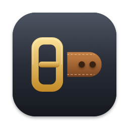

🇧🇷 [Português](README.md)

<p align="center">
  
</p>

<h1 align="center">Toolbelt</h1>

<p align="center">
  <b>Six menu bar utilities in a single ~13 MB app for macOS.</b><br>
  Icons hidden behind the notch, a window switcher, clipboard history,<br>
  window shortcuts, a system monitor and Claude Code accounts.
</p>

<p align="center">
  <a href="https://toolbelt.oconde.dev/download"><b>⬇︎ Download for macOS</b></a>
  &nbsp;·&nbsp;
  <a href="https://toolbelt.oconde.dev/en/">Website</a>
  &nbsp;·&nbsp;
  <a href="CHANGELOG.md">What's new</a>
</p>

<p align="center">
  
  
  
  
  
</p>

---

## Install

With [Homebrew](https://brew.sh):

```bash
brew install --cask nandobrazil/tap/toolbelt
```

If Homebrew warns that the tap is untrusted, run `brew trust --tap nandobrazil/tap` once.

Or by hand:

1. **Download** [Toolbelt.dmg](https://toolbelt.oconde.dev/download).
2. **Open the DMG and drag** Toolbelt into the Applications folder.
3. **Open Toolbelt.** The belt shows up in the menu bar. When macOS asks, allow it in **System Settings → Privacy & Security → Accessibility**.

That's it. The app is signed with a Developer ID and notarized by Apple, so it opens without the unverified software warning. It adds itself to your Login Items and keeps itself up to date: when a new version is out, you get a notice in the belt's panel and a notification with an **Update Now** button.

> **Coming from AltTab, Ice/Bartender, Flycut or Rectangle?** Quit them first (no need to uninstall): they do the same jobs with the same shortcuts, and they'll keep stealing each other's keys.

**Requirements:** macOS 14 Sonoma or later, Apple Silicon or Intel. Claude accounts and the full system report use `python3` (it comes with the Xcode Command Line Tools).

**Uninstall:** quit from the belt's menu (**Quit Toolbelt**) and delete the app from Applications. Settings live in `~/Library/Preferences/dev.oconde.toolbelt.plist` and history in `~/Library/Application Support/Toolbelt`.

## What's on the belt

| | Module | What it does |
|---|---|---|
| 🧷 | **Menu bar** | Hides the icons that don't fit (including the ones that vanish behind the notch) and shows all of them in a panel below the belt. Next to the belt, optionally: Claude account and usage, RAM, swap or free disk. ⌥-click to arrange the bar. |
| 🪟 | **Window switcher** | ⌥⇥ shows every open window, with ⇧ to go back. It also takes ⌘⇥, replacing the macOS switcher while Toolbelt is running. ⌥\` cycles through the current app's windows only. `/` searches; W closes the window, M minimizes it, H hides the app and Q quits it. Optional thumbnails. |
| 📋 | **Clipboard** | ⌥⌘V opens your history of text, images and screenshots without taking focus from the app you're in; one click pastes. Skips the apps you choose (password managers) and, if you want, keeps one `.md` file per day. |
| ▦ | **Windows** | Rectangle-style ⌃⌥ shortcuts: halves, thirds, corners, maximize, center and move between displays, with a configurable gap. |
| 📈 | **System monitor** | Free RAM, swap and disk, with alerts when memory gets tight or the disk fills up, plus a full report (battery, storage, CPU, processes, security, network). |
| ✳︎ | **Claude accounts** | Several Claude Code accounts side by side, with 5-hour and weekly usage, a colored badge per account and a terminal already pinned to each one. |

Every module turns on and off in **Settings → General**, and every shortcut can be re-recorded.

### Default shortcuts

| Action | Shortcut |
|---|---|
| Switch between all windows | ⌥⇥ (or ⌘⇥, if you choose) |
| Switch between the current app's windows | ⌥\` |
| Clipboard history | ⌥⌘V |
| Left / right / top / bottom half | ⌃⌥ ← → ↑ ↓ |
| Maximize · center | ⌃⌥ ↩ · ⌃⌥ C |
| Thirds: first · center · last | ⌃⌥ D · F · G |
| Two thirds: left · right | ⌃⌥ E · T |
| Corners | ⌃⌥ U · I · J · K |
| Next · previous display | ⌃⌥⌘ → · ⌃⌥⌘ ← |

## Genuinely light

Toolbelt stays open all day, so every megabyte counts: **~13 MB of memory and 0% CPU when idle**. It doesn't poll for anything. It reacts to system events (files changing, apps launching, the next Claude reset time) and sleeps the rest of the time.

## Privacy

Everything stays on your Mac: no account, no telemetry, no analytics. The app only goes online for:

- **Updates:** one daily request to `toolbelt.oconde.dev/updates/latest.json` (you can turn it off in **Settings → General → Updates**). Every downloaded update has its SHA-256 and signature verified before it replaces the app.
- **Crash reports, only with your permission:** when Toolbelt quits or hangs unexpectedly, it asks whether it may send the technical report (error type, where it failed, app and macOS versions, Mac model). You pick **Send**, **Always send** or **Not now**, and can change it later in **Settings → Help & reports**.
- **Reporting a problem or a suggestion:** from the belt menu, with an exact preview of what will be sent. Your email is optional.

Nothing you copy, open or type leaves your Mac.

## Permissions

| Permission | What for | Required |
|---|---|---|
| Accessibility | Pasting, moving windows, opening hidden icons and switching windows | Yes |
| Screen Recording | Only for the switcher's thumbnails (off by default) | No |
| Notifications | Monitor alerts and update notices | No |
| Automation (Terminal) | Opening Terminal already signed in to a Claude account | No |

## For developers

```bash
git clone https://github.com/nandobrazil/toolbelt.git && cd toolbelt
scripts/create-signing-identity.sh
scripts/install.sh
```

`create-signing-identity.sh` creates the local certificate once, which keeps permissions across builds. `install.sh` builds in release mode (Swift 5.9, no dependencies), assembles `~/Applications/Toolbelt.app` and opens it; with a Developer ID certificate in the Keychain it signs with it and installs into `/Applications` instead.

- [Architecture and modules](docs/architecture.md) (Portuguese)
- [How to publish a release](docs/releasing.md): Developer ID, notarization, DMG and automatic updates (Portuguese)
- [Status and decisions](docs/progress.md) (Portuguese)
- [Landing and app preview](docs/landing.md) (Portuguese)

Contributions are welcome: open an issue for bugs and ideas, or a pull request. Tests (`swift test`) run on macOS 14, 15 and 26 on every change. Crashes and suggestions can also be sent from inside the app, in **Settings → Help & reports**.

## License

[GPL-3.0](LICENSE): use, study, modify and redistribute freely; modified versions you distribute must stay open source under the same license. The "Toolbelt" name and icon identify this project.

<p align="center"><sub>Made by Fernando Conde · © 2026</sub></p>
